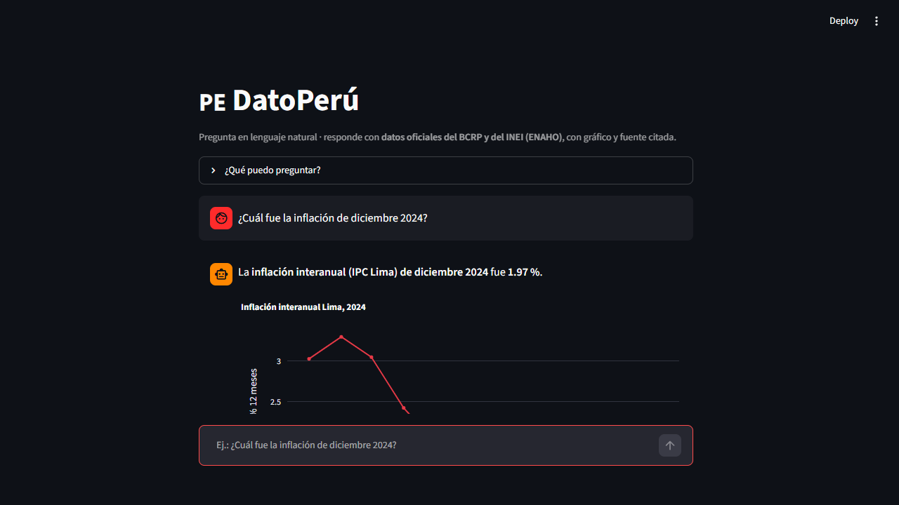

# 🇵🇪 DatoPerú

> **One-liner:** *DatoPerú responde en segundos preguntas sobre la economía y la
> pobreza del Perú para periodistas, estudiantes y funcionarios, mediante el
> servidor MCP del BCRP y las Skills de la ENAHO — cada cifra con su fuente
> oficial citada.*



---

## 1. One-liner

**Hacemos** preguntables los datos oficiales del Perú **para** quienes escriben,
estudian o deciden con cifras (periodistas, tesistas, analistas de gestión
pública, municipalidades) **mediante** un asistente conversacional que consulta
las series del BCRP (MCP) y los microdatos de la ENAHO (Skills) y responde con
el dato, el gráfico y la fuente.

## 2. Founder

**Jonatan Amaya** — estudiante de la Diplomatura de Especialización en Ciencia de
Datos para las Ciencias Sociales y la Gestión Pública (Q-Lab, PUCP). Viene de
construir, durante la diplomatura, el servidor MCP del BCRP (Tarea 4: 10/10
pruebas) y el pipeline ENAHO con validaciones oficiales (27.53 % de pobreza,
108,664 personas, 25 departamentos). DatoPerú convierte ese trabajo de curso en
producto.

## 3. Problema

**Quién lo sufre:** periodistas y comunicadores que citan cifras macro; tesistas
y estudiantes de ciencias sociales que necesitan datos para sus análisis;
profesionales de programas sociales y municipalidades que reportan indicadores.

**Cuánto le cuesta:** una cifra oficial simple (p. ej., "¿cuál fue la inflación
de diciembre 2024?") toma 20–40 minutos: encontrar el portal correcto, descargar
la serie, depurar, verificar vigencia y citar. Sumado a cada pregunta, es horas
por semana por persona.

**Cómo lo resuelve hoy:** navegación manual entre el portal de series del BCRP
(17,167 series), las notas de prensa del INEI y descargas Stata de la ENAHO, con
copiado manual a Excel. Los LLMs genéricos responden de memoria: rápido, pero sin
fuente verificable y con riesgo de cifra inventada.

**Notas de 3 conversaciones con usuarios potenciales:** `docs/research/`
(entrevistas breves a una periodista, una tesista y un analista de un programa
social — resumen de dolores y lenguaje usado).

## 4. Solución e insight

Un asistente web: escribes la pregunta en español natural y recibes la cifra
exacta, su gráfico y la cita (código de serie, periodo, fuente).

- **Insight 1:** el valor no es "la IA sabe la cifra" (los LLMs ya la recuerdan
  aproximada); el valor es **la cifra exacta, vigente y citable** — verificable
  en un clic contra la fuente oficial.
- **Insight 2:** la confianza se gana mostrando el instrumento: código de serie
  del BCRP (`PN01273PM`), factor de expansión de la ENAHO (`facpob07`) y fecha de
  consulta. Nadie más muestra la trazabilidad.

## 5. Why now

- Los microdatos y series oficiales del Perú son ya públicos y estables (ENAHO
  anual del INEI; API de series del BCRP).
- El patrón **MCP + Skills** (del curso) permite encapsular el acceso a esas
  fuentes como herramientas reutilizables por cualquier agente.
- Los anti-bots del Estado (PerimeterX en el BCRP, 2026) hacen que "saber bajar"
  sea una ventaja técnica real que el asistente ya resuelve (caché de respuestas
  oficiales + navegador real).

## 6. Demo

**Corre en local (2 minutos):**

```bash
git clone https://github.com/jonatan-amaya/dato-peru.git
cd dato-peru
pip install -r requirements.txt   # o: uv pip install streamlit pandas plotly httpx
streamlit run app.py              # http://localhost:8501
```

**Video de respaldo (75 s):** `static/video_respaldo.mp4` · capturas en `static/`.

Arquitectura:

```text
pregunta (chat Streamlit)
   └─ engine/router.py ── clasifica intención
        ├─ engine/bcrp_tools.py ── catálogo oficial (17,167 series) + API/cache → cifra + gráfico
        └─ engine/enaho.py ── indicadores ENAHO ponderados (facpob07) + mapa Plotly
```

**Modelos/APIs usados y por qué:** API pública de series del BCRP
(`estadisticas.bcrp.gob.pe/estadisticas/series/api`) porque es la fuente oficial
vigente; microdatos ENAHO 2024 del INEI porque es la encuesta oficial de hogares.
No se usa LLM en el camino crítico: el router es determinista (auditable, cero
alucinación, cero costo por consulta); una LLM opcional podría añadirse para
paráfrasis sin tocar el cálculo.

## 7. Modelo de negocio

- **Quién paga:** medios y agencias de comunicación, consultoras de políticas
  públicas, programas de cooperación y municipalidades (plan de equipo), más
  tesistas (plan individual).
- **Precio concreto:** gratis para uso individual con límite de 20 consultas/día;
  **S/ 49/mes** por usuario profesional (consultas ilimitadas, historial y
  exportación); **S/ 399/mes** por equipo/institución (hasta 10 usuarios,
  marcas blanca y soporte).
- **Costo por usuario:** el flujo actual es determinista y sin LLM: ~S/ 0.003 por
  consulta (solo compute en Streamlit Cloud free tier / VPS de S/ 30/mes que
  soporta ~10k consultas/mes). Si se habilita LLM para paráfrasis: ~S/ 0.01 por
  consulta (modelo pequeño), costo absorbido por el plan de pago.

## 8. Herramientas del curso (dentro del producto)

| Herramienta (sesión) | Dónde está en el producto | Qué hace |
|---|---|---|
| **MCP del BCRP** (sesión 04) | `engine/bcrp_tools.py` (misma lógica que `mcp/server.py` de la Tarea 4) | Búsqueda en catálogo oficial, descarga de series, resúmenes calculados |
| **Skills ENAHO** (sesión 16) | `engine/enaho.py` + `datos/*.csv` generados por el pipeline `limpiando-enaho` | Indicadores de pobreza ponderados (facpob07) y tabla departamental |

Además usa visualización (sesión 05) para los gráficos y mapas. *Claude Code /
Kimi Code se usaron para construir, no cuentan como herramienta del producto.*

## 9. Qué hizo el agente

El agente de código (Kimi Code) generó: el esqueleto del proyecto, el router de
intenciones, la adaptación de las herramientas MCP al motor, la UI Streamlit, el
empaquetado de datos, el video de respaldo (TTS + música sintetizada) y este
README. Las decisiones de diseño, la verificación de cifras contra las fuentes
oficiales y la validación ENAHO (27.53 % vs 27.6 % oficial) fueron revisadas y
ejecutadas en conjunto; el founder puede explicar y modificar cualquier parte.

---

## Anexo · Reproducibilidad de los datos

- `datos/catalogo_bcrp.csv` — catálogo oficial del BCRP (snapshot 2026-11-02).
- `datos/cache_bcrp/*.json` — respuestas oficiales de la API del BCRP (IPC, tipo
  de cambio, tasa de referencia, desempleo Lima) obtenidas con navegador real
  por la protección anti-bot del portal.
- `datos/pobreza_departamentos.csv` e `indicadores_enaho.csv` — calculados desde
  los microdatos ENAHO 2024 (módulos 34 y 02) con el pipeline de la Tarea 4
  (`limpiando-enaho`); la fuente original es pública del INEI (código 966).
- `datos/peru_departamental_simple.geojson` — límites departamentales (repositorio
  del curso, sesión geoespacial).
- `scripts/` — generación del video y (próximamente) actualización de datos.
